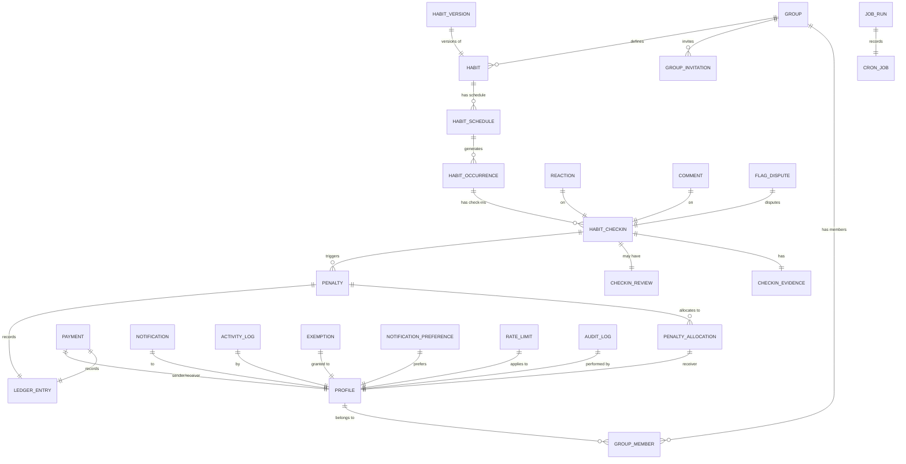
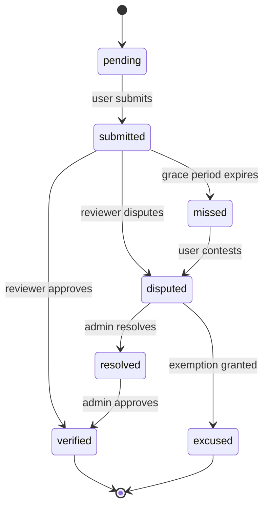
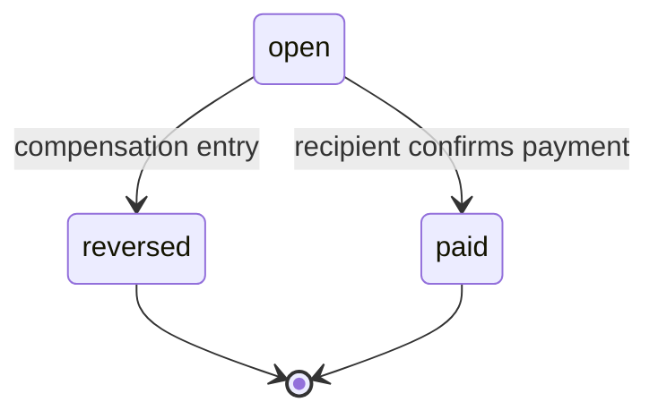
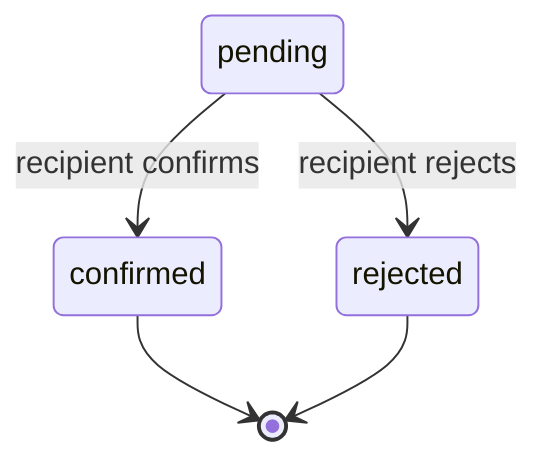
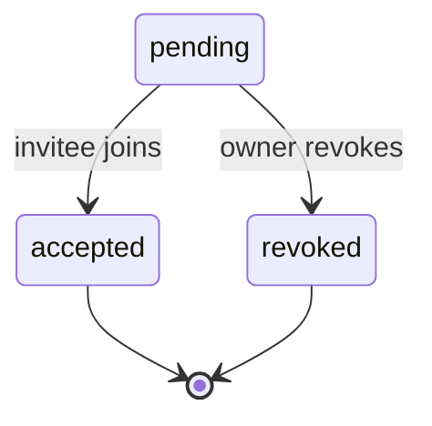

# 02 – Database Schema

## Entity‑Relationship Diagram (Mermaid)

## Core Tables (selected columns, types, constraints, indexes)

| Table | Columns (type) | Primary Key | Notable Constraints / Indexes |
|-------|----------------|-------------|-------------------------------|
| **profiles** | `id uuid PK`, `email text UNIQUE NOT NULL`, `name text`, `timezone text NOT NULL`, `created_at timestamptz DEFAULT now()` | `id` | RLS on `id`; index on `email` |
| **groups** | `id uuid PK`, `name text NOT NULL`, `currency text NOT NULL`, `owner_id uuid NOT NULL`, `created_at timestamptz` | `id` | FK `owner_id → profiles.id`; RLS owner/admin/member |
| **group_members** | `group_id uuid PK`, `profile_id uuid PK`, `role text CHECK (role IN ('owner','admin','member')) NOT NULL`, `joined_at timestamptz` | composite `(group_id,profile_id)` | index on `profile_id`; RLS based on group membership |
| **group_invitations** | `id uuid PK`, `group_id uuid NOT NULL`, `email text NOT NULL`, `status text CHECK (status IN ('pending','accepted','revoked')) NOT NULL`, `created_at timestamptz` | `id` | unique (`group_id,email`) for pending invites |
| **habits** | `id uuid PK`, `group_id uuid NOT NULL`, `name text NOT NULL`, `timezone text NOT NULL`, `created_at timestamptz` | `id` | FK `group_id → groups.id`; RLS on group |
| **habit_versions** | `id uuid PK`, `habit_id uuid NOT NULL`, `version integer NOT NULL`, `payload jsonb NOT NULL`, `effective_from timestamptz NOT NULL` | `id` | unique (`habit_id,version`); FK `habit_id → habits.id`
| **habit_schedules** | `id uuid PK`, `habit_id uuid NOT NULL`, `frequency text CHECK (frequency IN ('daily','weekly','monthly','custom')) NOT NULL`, `target_quantity integer NOT NULL`, `custom_cron text`, `created_at timestamptz` | `id` | FK `habit_id → habits.id`
| **habit_occurrences** | `id uuid PK`, `schedule_id uuid NOT NULL`, `period_start timestamptz NOT NULL`, `period_end timestamptz NOT NULL`, `status text CHECK (status IN ('pending','evaluated')) NOT NULL`, `created_at timestamptz` | `id` | unique (`schedule_id,period_start`); FK `schedule_id → habit_schedules.id`
| **habit_checkins** | `id uuid PK`, **`occurrence_id uuid NOT NULL`**, `profile_id uuid NOT NULL`, `quantity integer NOT NULL`, `status text CHECK (status IN ('pending','submitted','verified','missed','disputed','excused')) NOT NULL`, `created_at timestamptz` | `id` | FK `occurrence_id → habit_occurrences.id`; FK `profile_id → profiles.id`; unique (`occurrence_id,profile_id`)
| **checkin_evidence** | `id uuid PK`, `checkin_id uuid NOT NULL`, `storage_path text NOT NULL`, `uploaded_at timestamptz`, `status text CHECK (status IN ('required','uploaded','rejected')) NOT NULL` | `id` | FK `checkin_id → habit_checkins.id`; RLS ensures only owner or reviewer can view |
| **checkin_reviews** | `id uuid PK`, `checkin_id uuid NOT NULL`, `reviewer_id uuid NOT NULL`, `decision text CHECK (decision IN ('approved','rejected','escalated')) NOT NULL`, `comment text`, `created_at timestamptz` | `id` | FK `checkin_id → habit_checkins.id`; unique (`checkin_id,reviewer_id`)
| **penalties** | `id uuid PK`, `occurrence_id uuid NOT NULL`, `offender_id uuid NOT NULL`, `amount bigint NOT NULL`, `snapshot jsonb NOT NULL`, `status text CHECK (status IN ('open','reversed','paid')) NOT NULL`, `created_at timestamptz` | `id` | unique (`occurrence_id`); FK `occurrence_id → habit_occurrences.id`
| **penalty_allocations** | `penalty_id uuid PK`, `receiver_id uuid PK`, `share bigint NOT NULL` | composite `(penalty_id,receiver_id)` | FK `penalty_id → penalties.id`; check sum via trigger |
| **ledger_entries** | `id uuid PK`, `group_id uuid NOT NULL`, `type text CHECK (type IN ('debit','credit','adjust')) NOT NULL`, `amount bigint NOT NULL`, `metadata jsonb`, `created_at timestamptz` | `id` | append‑only (triggers block UPDATE/DELETE); FK `group_id → groups.id`
| **payments** | `id uuid PK`, `sender_id uuid NOT NULL`, `receiver_id uuid NOT NULL`, `group_id uuid NOT NULL`, `amount bigint NOT NULL`, `status text CHECK (status IN ('pending','confirmed','rejected')) NOT NULL`, `evidence_path text`, `created_at timestamptz` | `id` | FK `group_id → groups.id`; unique (`sender_id,receiver_id,group_id,created_at`)
| **notifications** | `id uuid PK`, `profile_id uuid NOT NULL`, `channel text CHECK (channel IN ('inapp','email','webpush')) NOT NULL`, `payload jsonb NOT NULL`, `read_at timestamptz`, `created_at timestamptz` | `id` | index on `profile_id,read_at`
| **activity_logs** | `id uuid PK`, `profile_id uuid NOT NULL`, `action text NOT NULL`, `details jsonb`, `created_at timestamptz` | `id` | index on `profile_id,created_at`
| **exemptions** | `id uuid PK`, `profile_id uuid NOT NULL`, `habit_id uuid NOT NULL`, `reason text`, `expires_at timestamptz`, `created_at timestamptz` | `id` | unique (`profile_id,habit_id`)
| **reactions** | `id uuid PK`, `checkin_id uuid NOT NULL`, `profile_id uuid NOT NULL`, `type text NOT NULL`, `created_at timestamptz` | `id` | unique (`checkin_id,profile_id,type`)
| **comments** | `id uuid PK`, `checkin_id uuid NOT NULL`, `profile_id uuid NOT NULL`, `body text NOT NULL`, `created_at timestamptz` | `id` | index on `checkin_id`
| **flag_disputes** | `id uuid PK`, `checkin_id uuid NOT NULL`, `reporter_id uuid NOT NULL`, `reason text NOT NULL`, `status text CHECK (status IN ('open','resolved','dismissed')) NOT NULL`, `created_at timestamptz` | `id` | unique (`checkin_id,reporter_id`)
| **notification_preferences** | `profile_id uuid PK`, `channel text NOT NULL`, `enabled boolean NOT NULL` | `profile_id,channel` | index on `profile_id`
| **cron_job** | `id uuid PK`, `name text NOT NULL`, `schedule_cron text NOT NULL`, `handler text NOT NULL`, `enabled boolean DEFAULT true`, `last_run_at timestamptz` | `id` | unique (`name`)
| **job_runs** | `id uuid PK`, `job_id uuid NOT NULL`, `run_id uuid NOT NULL`, `started_at timestamptz`, `finished_at timestamptz`, `status text CHECK (status IN ('success','failed')) NOT NULL` | `id` | unique (`job_id,run_id`)
| **rate_limits** | `id uuid PK`, `profile_id uuid NOT NULL`, `action text NOT NULL`, `window_seconds integer NOT NULL`, `max_calls integer NOT NULL`, `reset_at timestamptz` | `id` | unique (`profile_id,action`)
| **audit_log** | `id uuid PK`, `profile_id uuid NOT NULL`, `action text NOT NULL`, `details jsonb`, `created_at timestamptz` | `id` | index on `profile_id,action`

## State Machines

### Check‑in Status

### Penalty Status

### Payment Status

### Invitation Status

## RLS Policy Matrix (simplified)
| Table | Owner | Admin | Member | Non‑member |
|-------|-------|-------|--------|------------|
| profiles | SELECT/UPDATE own row | SELECT any | SELECT own | ❌ |
| groups | SELECT/UPDATE own | SELECT/UPDATE any | SELECT any | ❌ |
| group_members | SELECT own membership | SELECT/INSERT/UPDATE/DELETE any | SELECT own | ❌ |
| group_invitations | SELECT/INSERT/UPDATE own | SELECT/UPDATE any | ❌ | ❌ |
| habits | SELECT/INSERT/UPDATE own | SELECT/INSERT/UPDATE any | SELECT any | ❌ |
| habit_checkins | SELECT/INSERT own | SELECT any | SELECT own | ❌ |
| penalties | SELECT own | SELECT/UPDATE any | SELECT own | ❌ |
| ledger_entries | SELECT own | SELECT any | SELECT own | ❌ |
| payments | SELECT own | SELECT any | SELECT own | ❌ |
| notifications | SELECT own | SELECT any | SELECT own | ❌ |
| audit_log | SELECT own | SELECT any | SELECT own | ❌ |

*All policies are expressed with `auth.uid()` and `group_id` joins; no `USING (true)` shortcuts.*

## Migration Plan (high‑level)
1. **Phase 0 – Baseline** – existing tables from earlier sprint.
2. **Add new tables** – `habit_versions`, `exemptions`, `ledger_entries`, `reactions`, `comments`, `flag_disputes`, `notification_preferences`, `cron_job`, `job_runs`, `rate_limits`, `audit_log` (each in its own migration file, ordered alphabetically to satisfy FK dependencies).
3. **Alter existing tables** – add columns (`timezone` to `habits`, `snapshot` to `penalties`, `status` enums, indexes).
4. **Create RLS policies** – one migration per table defining `SELECT`, `INSERT`, `UPDATE`, `DELETE` policies.
5. **Add triggers** – append‑only enforcement on `ledger_entries` and `audit_log`; checksum trigger on `penalty_allocations` to enforce sum.
6. **Seed data** – default notification channels, admin role seeds.
7. **Test scaffolding** – pgTAP files for each function/policy.

All migrations are written in `supabase/migrations/` and will be applied sequentially by `supabase db reset`.

---
*The schema document provides the ERD, table definitions, state machines, RLS matrix, and a migration roadmap needed to implement the product.*